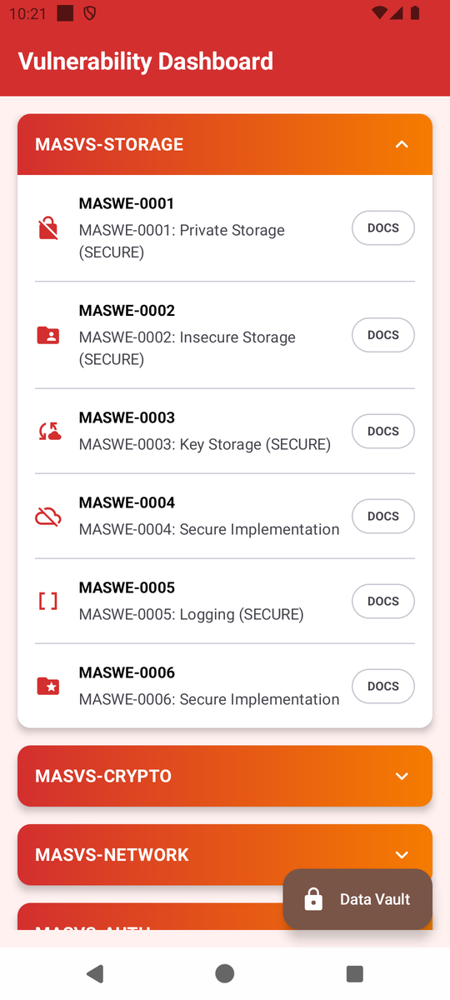
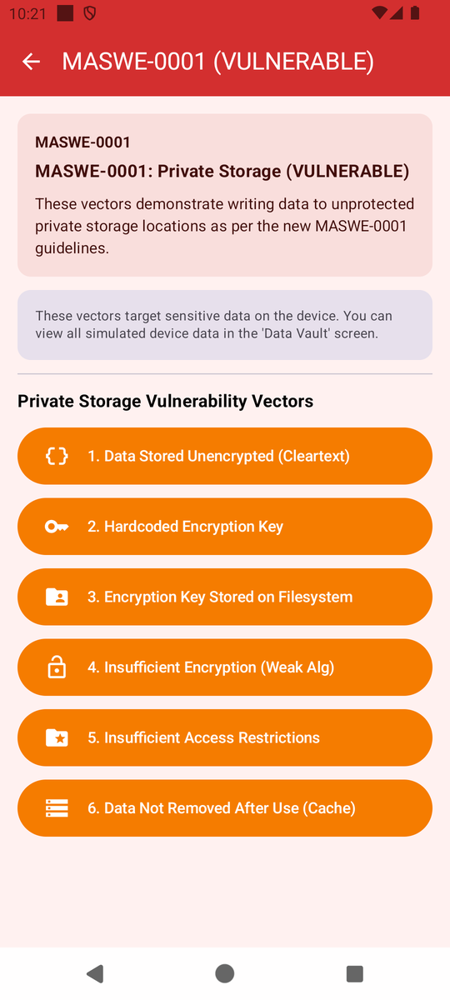
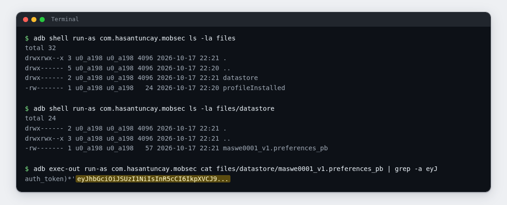
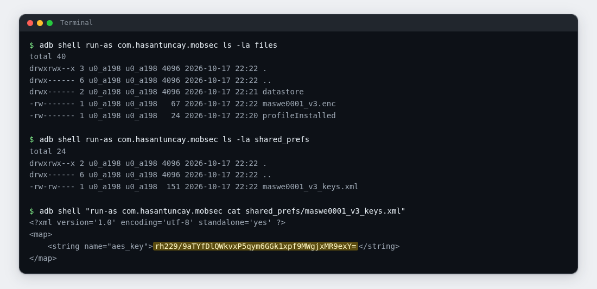

# Lab 01: The Token That Stayed in Plain Sight

| | |
|---|---|
| **Module** | [MASWE-0001: Sensitive Data Stored Unencrypted in Private Storage](../maswe/MASVS-STORAGE/maswe_001/MASWE-0001-Insecure-Private-Storage.md) |
| **Category** | MASVS-STORAGE |
| **CWE** | CWE-312: Cleartext Storage of Sensitive Information |
| **Time** | ~25 minutes |
| **Level** | Beginner |
| **Needs** | [Lab rules](index.md#before-you-conduct-any-lab) read · [Lab 00: Setup](setup.md) complete · **🎯 MobSec Victim** installed · `adb` working |

!!! info "Self-paced lab"
    Tap the demo buttons to create the test data, then inspect the files from your terminal. Use your command output as evidence. Section E lists what to submit.

---

## A · Requirement

The app stores a signed access token that authenticates the user. It should keep the token where nothing outside the app can read it, and its encryption keys should be just as private.

Store a token in the app and check whether you can read it from disk. For the encrypted record, locate the key and check whether the same access lets you read it too.

The demo buttons may display file paths and a result summary. Verify those claims by inspecting the files yourself.

Do not read the project source code. Use the installed app and your terminal.

---

## B · Validation

Run everything in one terminal (Git Bash on Windows). This lab needs the emulator running and the app installed.

### 1. Take a "before" reading

List the app's own file storage before you touch the app:

```bash
adb shell run-as com.hasantuncay.mobsec ls -la files
adb shell run-as com.hasantuncay.mobsec ls -la files/datastore
```

`run-as` opens the app's private folder as the app itself. It works because Lab 00 installs a debug build. On a normal phone, the same read needs root.

Expected: the first command lists a short set of entries, or prints `No such file or directory`. The second usually prints `No such file or directory`. Save this output so you can compare it with the listing after the write.

!!! tip "The app writes a result card after every button"
    Leave the result card unread until you have inspected the files. Capture your terminal output for the evidence in section E.

### 2. Make the app store the value

Open **🎯 MobSec Victim**. The dashboard groups modules by category. Tap `MASVS-STORAGE` to expand it:

{ width="360" }

Then open the `MASWE-0001` row.

!!! note "Incorrect dashboard subtitle"
    The row subtitle reads `MASWE-0001: Private Storage (SECURE)`. That wording is a bug in this training build. The screen title bar is what counts, and it says `MASWE-0001 (VULNERABLE)`.

The module screen lists six vectors. This lab uses the first and the third:

{ width="380" }

Tap the first button: `1. Data Stored Unencrypted (Cleartext)`.

### 3. Look again

```bash
adb shell run-as com.hasantuncay.mobsec ls -la files
adb shell run-as com.hasantuncay.mobsec ls -la files/datastore
```

Expected: `files` now contains a `datastore` directory, and inside it is one file, `maswe0001_v1.preferences_pb`. Some DataStore versions also leave a small lock file next to it; this one does not. Owner, size, and date are whatever your emulator reports; the name is the part that matters.

```text
-rw------- 1 u0_a2XX u0_a2XX  1234 2026-..-.. ..:.. maswe0001_v1.preferences_pb
```

Compare this with step 1 to identify the file created by the button tap.

### 4. Read the stored value

The file is not plain text; it is a protobuf blob with the token embedded. `grep` with `-a` reads it as text and keeps the readable run:

```bash
adb exec-out run-as com.hasantuncay.mobsec cat files/datastore/maswe0001_v1.preferences_pb | grep -a eyJ
```

Expected: a single line containing `auth_token` and a value that begins with `eyJhbGciOiJSUzI1NiIsInR5cCI6IkpXVCJ9`. A few unprintable bytes from the protobuf wrapper may sit around it. Copy the `eyJ...` run into your notes exactly; in this training data it ends with three dots.



If `grep` prints nothing, check the file path and tap the vector again. Wait two seconds, then rerun the command.

### 5. Create an encrypted record

Go back to the app screen and tap the third button: `3. Encryption Key Stored on Filesystem`.

### 6. Locate the encrypted record and key file

```bash
adb shell run-as com.hasantuncay.mobsec ls -la files
adb shell run-as com.hasantuncay.mobsec ls -la shared_prefs
```

Expected: `files` gained `maswe0001_v3.enc`, and `shared_prefs` gained `maswe0001_v3_keys.xml`. These contain the encrypted record and its key, respectively. Ignore unrelated XML files from earlier app starts.

### 7. Read the key

```bash
adb shell "run-as com.hasantuncay.mobsec cat shared_prefs/maswe0001_v3_keys.xml"
```

Expected: a small XML file with one entry, `<string name="aes_key">` followed by a long base64 value. That value is the AES key the app used for `maswe0001_v3.enc`. It sits in the same storage, one folder over, in the clear.



### 8. Optional: let the project's checker confirm it

If you have the project repository on this machine, the module ships a script that looks for the same two artifacts:

```bash
bash features/maswe0001/poc/adb_verify.sh
```

Expected: `[!] CRITICAL VULNERABILITY CONFIRMED (MASWE-0001 / CWE-312):` followed by the files it could read, including the one from step 4. The script also checks files from other storage vectors. Those additional results are not required for this lab.

---

## C · Questions

Answer these in your notes before moving on:

1. ✍️ The `datastore` folder lives inside the app's private storage. Who can normally read that folder on a real phone, and what made it readable for you without root?
2. ✍️ Vector 3 did encrypt the data. Explain in your own words why the finding stands anyway: where did the key end up, and what does that mean for someone holding a copy of the device storage?
3. ✍️ What can an attacker do with the value you pulled out in step 4? Name one concrete action.

---

## D · Finding

You have the finding when all four are true:

| Test | What it shows |
|---|---|
| The step 3 listing | A new file appeared in the app's private storage right after the app processed data |
| The step 4 output | The app stored a usable token in cleartext, readable byte for byte, with no decryption step anywhere |
| The steps 6 and 7 outputs | The app's encrypted file keeps its AES key in a separate file in the same private storage |
| Section C, question 3 | One sentence of impact: what an attacker does with what they read |

If you ran step 8, its output is a second, independent confirmation of the same files. Attach it as well.

---

## E · Evidence

Hand in:

1. 📷 Screenshot 1: your terminal with the step 3 listing and the step 4 output. The token value must be readable, not cut off.
2. 📷 Screenshot 2: the step 6 listing and the step 7 key file.
3. ✍️ Two or three sentences, in your own words:
   - what was stored without encryption and where,
   - why storing the key this way leaves the encrypted record exposed,
   - one concrete thing an attacker could do with the token.

Submit these through your training channel. No long report is needed.

---

## F · Hints

??? question "Hint 1: the app or the buttons are not where I expect"
    - The dashboard groups modules under category cards. Expand `MASVS-STORAGE` first.
    - The row subtitle may mention SECURE; ignore it and check the screen title bar for `MASWE-0001 (VULNERABLE)`.
    - Only buttons 1 and 3 matter for this lab. If a tap produces no visible change, tap it again and give the app a second to write.

??? question "Hint 2: storage looks empty or different from the page"
    - List first, tap second, list again third: step 1 records the snapshot, step 3 shows the change.
    - `run-as: package not debuggable` means the release build is installed. Reinstall the debug APK from Lab 00.
    - `ls` may print `No such file or directory` for `files/datastore` until vector 1 has run once.

??? question "Hint 3: the cat output is noisy or empty"
    - The DataStore file is binary with the token inside. Run the step 4 pipe exactly as written: `adb exec-out ... | grep -a eyJ`.
    - If the pipe prints a warning about binary data, you dropped the `-a`. It is the flag that keeps the matches readable.
    - The XML key file is plain text, so step 7 needs no pipe. If it prints nothing, the vector 3 tap did not land.

---

## G · Explanation

!!! warning "Open only after sections C and E are done"
    Complete your answers and capture your evidence before opening the explanation.

??? question "What happened on disk"
    MASWE-0001 covers CWE-312: Cleartext Storage of Sensitive Information.

    Vector 1 wrote an OAuth-style bearer token into a Jetpack DataStore file (`files/datastore/maswe0001_v1.preferences_pb`) without encryption. The protobuf format stores readable token bytes, which is why the text search recovered the value.

    Vector 3 encrypted the record with AES but stored the AES key in `shared_prefs/maswe0001_v3_keys.xml`. Access to both locations allows an attacker to copy the ciphertext and the key needed to decrypt it. Root malware or a forensic image can provide that access, as did your inspection of this debug build.

    The module demonstrates four more storage habits on its other buttons: a key hardcoded in the app package, AES in ECB mode, a FileProvider whose path config maps far more of the filesystem than it should, and a cache file that is never deleted.

    Why it matters:

    - Tokens recovered from storage authenticate as the user until they expire or are revoked.
    - Private storage restricts ordinary app access. Root access, a device image, or debugging access can still expose the files, so sensitive data needs encryption with a separately protected key.
    - Copying both the key file and the encrypted record defeats the protection demonstrated in vector 3.

    What the secure app does instead:

    The `:app-secure` implementation keeps its encryption keys in the Android Keystore and wraps storage with Tink AEAD (`AndroidKeystore` master key, encrypted DataStore serializer). Vector 3's secure counterpart uses envelope encryption, with the key-encrypting key in hardware and only a wrapped data key on disk.

    Go deeper:

    - Reference page: [MASWE-0001: Sensitive Data Stored Unencrypted in Private Storage](../maswe/MASVS-STORAGE/maswe_001/MASWE-0001-Insecure-Private-Storage.md)
    - The vulnerable code lives in `features/maswe0001/src/main/java/com/hasantuncay/mobsec/maswe0001/vulnerable/Maswe0001VulnerableRepository.kt`.
    - The module's automation is in `features/maswe0001/poc/`: a Semgrep rule for CI scanning, a Frida hook for runtime inspection, and the `adb` script from step 8.
