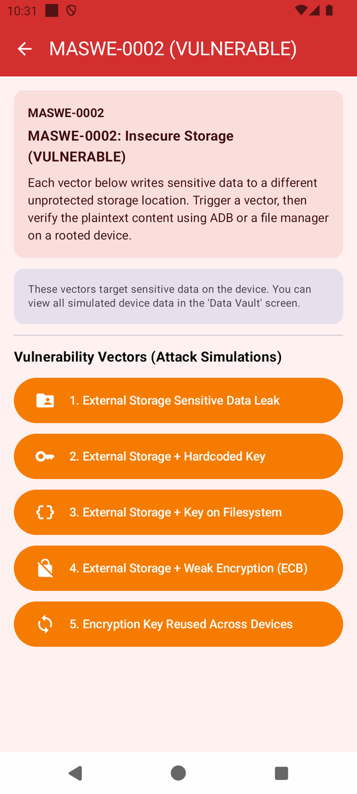
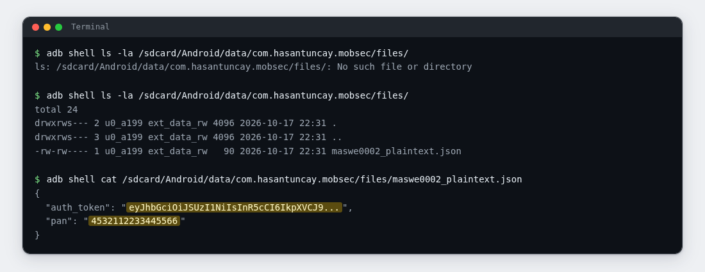
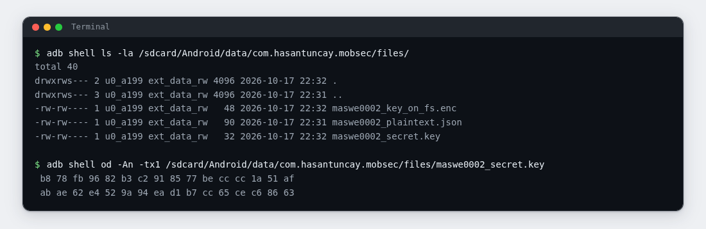

# Lab 02: Outside the Sandbox

| | |
|---|---|
| **Module** | [MASWE-0002: Sensitive Data Stored Unencrypted Outside of Private Storage](../maswe/MASVS-STORAGE/maswe_002/MASWE-0002-Insecure-Storage.md) |
| **Category** | MASVS-STORAGE |
| **CWE** | CWE-732: Incorrect Permission Assignment for Critical Resource |
| **Time** | ~25 minutes |
| **Level** | Beginner |
| **Needs** | [Lab rules](index.md#before-you-conduct-any-lab) read · [Lab 00: Setup](setup.md) complete · **🎯 MobSec Victim** installed · `adb` working |

!!! info "Self-paced lab"
    Inspect the files created by the demo buttons, then copy a record to your machine. The commands use the adb shell user; see Hint 1 if your emulator restricts access to the folder. Section E lists what to submit.

---

## A · Requirement

The app keeps sensitive records on the device, and it should keep them inside its own sandbox, where other apps cannot reach. Shared storage, the part of the device a PC can reach over USB, is not a place for anything sensitive.

Create a record and inspect its location, contents, and permissions. Copy it off the device, then check whether the encrypted record's key is accessible in the same location.

Do not read the project source code. Use the installed app and your terminal.

---

## B · Validation

Run everything in one terminal (Git Bash on Windows) and one folder of your choice.

!!! warning "Do not tap the DOCS button"
    The DOCS button opens the official OWASP explanation. Read it after completing your checks and capturing the evidence.

### 1. Look before

```bash
adb shell ls -la /sdcard/Android/data/com.hasantuncay.mobsec/files/
```

Expected on a fresh install: `No such file or directory`. The folder is created together with the app's first write. `/sdcard` is an alias for `/storage/emulated/0`; both spellings work.

### 2. Make the app write outside its sandbox

Open **🎯 MobSec Victim**, expand `MASVS-STORAGE`, and open the `MASWE-0002` row.

!!! note "Incorrect dashboard subtitle"
    The row subtitle may read `MASWE-0002: Insecure Storage (SECURE)`. That is a bug in this training build. The screen title bar is what counts: `MASWE-0002 (VULNERABLE)`.

The module lists five vectors. This lab needs the first and the third:

{ width="380" }

Tap the first button: `1. External Storage Sensitive Data Leak`. Ignore the app's result card, and leave DOCS alone.

### 3. Look again

```bash
adb shell ls -la /sdcard/Android/data/com.hasantuncay.mobsec/files/
```

Expected: the folder now exists and lists one file, `maswe0002_plaintext.json`. Owner and size are whatever your emulator reports.

### 4. Read the record

```bash
adb shell cat /sdcard/Android/data/com.hasantuncay.mobsec/files/maswe0002_plaintext.json
```

Expected: a small JSON object with two fields. `auth_token` holds a value that starts with `eyJhbGciOiJSUzI1NiIsInR5cCI6IkpXVCJ9` and ends with three dots, and `pan` holds a 16-digit card number that starts with `4532`.



!!! tip "Record which access you used"
    If the command succeeded without the Hint 1 fallback, the adb shell user could read the file without root or `run-as`.

    The result card's claim about API 29 refers to access by ordinary apps. Shell access can differ; record whether your emulator required the Hint 1 fallback.

### 5. Take it off the device

```bash
adb pull /sdcard/Android/data/com.hasantuncay.mobsec/files/maswe0002_plaintext.json .
cat maswe0002_plaintext.json
```

Expected: `1 file pulled, 0 skipped.` followed by the same JSON, now sitting on your machine. Newer `adb` versions print the source path and a transfer rate around that line.

### 6. Create the encrypted record

Go back to the module screen and tap the third button: `3. External Storage + Key on Filesystem`. Then:

```bash
adb shell ls -la /sdcard/Android/data/com.hasantuncay.mobsec/files/
```

Expected: two new files, `maswe0002_key_on_fs.enc` and `maswe0002_secret.key`.

### 7. Read the key

```bash
adb shell od -An -tx1 /sdcard/Android/data/com.hasantuncay.mobsec/files/maswe0002_secret.key
```

Expected: two lines of hex bytes, 32 in total. That is the AES key for the `.enc` file sitting next to it, written to the same shared folder. Run the same command on `maswe0002_key_on_fs.enc` if you want to see the ciphertext it protects.



### 8. Optional: let the project's checker confirm it

If you have the project repository on this machine, the module ships a script that repeats the key parts of this inspection:

```bash
bash features/maswe0002/poc/adb_verify.sh
```

Expected: `[!] CRITICAL VULNERABILITY CONFIRMED (MASWE-0002 / CWE-732):` followed by the plaintext record it could read from `/sdcard/Android/data/...` and the key file it found beside the ciphertext.

---

## C · Questions

Answer these in your notes before moving on:

1. ✍️ Lab 01 used `run-as` to read private files. Which access did you use here, including any Hint 1 fallback? Compare the two storage locations and who can reach them on a real device.
2. ✍️ Where did vector 3 store its encryption key? Explain what access to that file means for the encrypted record.
3. ✍️ You copied the record off the device in one command. Name one concrete thing an attacker can do with it.

---

## D · Finding

You have the finding when all four are true:

| Test | What it shows |
|---|---|
| The step 1 and step 3 listings | A file appeared outside the app's private sandbox, minutes after the app wrote it |
| The step 4 output | A readable token and card number; record whether the shell read succeeded directly or needed the Hint 1 fallback |
| The step 5 output | A copy of the record now exists on your machine, pulled with one command |
| The steps 6 and 7 outputs | The encrypted file and its readable AES key are in the same shared folder |

If you ran step 8, its output is a second, independent confirmation of the same artifacts. Attach it as well.

---

## E · Evidence

Hand in:

1. 📷 Screenshot 1: your terminal with the step 3 listing and the step 4 output. The token and the card number must be readable, not cut off.
2. 📷 Screenshot 2: the step 6 listing and the step 7 hex key, or the step 5 pull and host-side `cat`.
3. ✍️ Two or three sentences, in your own words:
   - what was written and to which kind of storage,
   - why the encrypted file does not fix the problem,
   - one concrete thing an attacker could do with the record.

Submit these through your training channel. No long report is needed.

---

## F · Hints

??? question "Hint 1: Permission denied on the folder"
    - Some emulator images restrict `/sdcard/Android/data` from the shell user. If yours does and it allows `adb root` (images without the Play Store do; Lab 00's default), run it, wait for the restart, then repeat the command.
    - This only applies to the read steps. If step 1 printed `No such file or directory`, that is not a permission problem; the folder simply does not exist yet.

??? question "Hint 2: the folder is still missing after the tap"
    - Confirm the tap landed: the button turns red and the app shows a result card you were told to ignore.
    - Wait a second and list again. The directory is created with the first write.
    - Check the package name in the path: `com.hasantuncay.mobsec`, no `.vulnerable` suffix.

??? question "Hint 3: od or cat misbehaves"
    - `od` is a standard part of the device shell. If it fails anyway, pull the file and inspect it on your machine: `adb pull .../maswe0002_secret.key .` then `od -An -tx1 maswe0002_secret.key`.
    - The JSON file is plain text, so `cat` is enough for it. If the output looks garbled, you are reading the wrong file.

---

## G · Explanation

!!! warning "Open only after sections C and E are done"
    Complete your answers and capture your evidence before opening the explanation.

??? question "Why the folder was readable"
    MASWE-0002 applies CWE-732: Incorrect Permission Assignment for Critical Resource to sensitive files outside private storage.

    Every vector in this module writes through `getExternalFilesDir()`, which lands in `/sdcard/Android/data/com.hasantuncay.mobsec/files/`. This is an app-specific directory on shared storage, outside the private sandbox. The JSON holds an unencrypted auth token and card number. On the emulator used to verify this lab, the adb shell user could read it directly; some images require the root fallback in Hint 1. Older Android versions also allowed access by other apps holding storage permission.

    Vector 3 encrypted the payload with AES and wrote its 32-byte key to `maswe0002_secret.key` in the same folder. A reader with access to both files can decrypt the payload. The other buttons demonstrate a hardcoded key, DES with the literal key `WeakKey1`, and a key derived from `ANDROID_ID`, which is stable per device and not a secret.

    Why it matters:

    - Card numbers and tokens are regulated data. PCI-DSS treats readable storage as a finding on its own.
    - A record in shared storage leaves the device easily: a file manager, a USB connection, a backup tool, or one `adb pull`.
    - Once copied, deleting the app or the file does not retract any copy.
    - The encrypted record remains exposed to anyone who can copy its key from the shared folder.

    What the secure app does instead:

    The `:app-secure` implementation writes through Jetpack Security's `EncryptedFile` (AES-256-GCM with an HKDF-derived key), with the master key held in the Android Keystore, and keeps the one plaintext copy inside the private sandbox. The key never leaves hardware-backed storage.

    Go deeper:

    - Reference page: [MASWE-0002: Sensitive Data Stored Unencrypted Outside of Private Storage](../maswe/MASVS-STORAGE/maswe_002/MASWE-0002-Insecure-Storage.md)
    - The vulnerable code lives in `features/maswe0002/src/main/java/com/hasantuncay/mobsec/maswe0002/vulnerable/Maswe0002VulnerableRepository.kt`.
    - The module's automation is in `features/maswe0002/poc/`: a Semgrep rule pack for CI, a Frida hook for runtime inspection, and the `adb` script from step 8.
