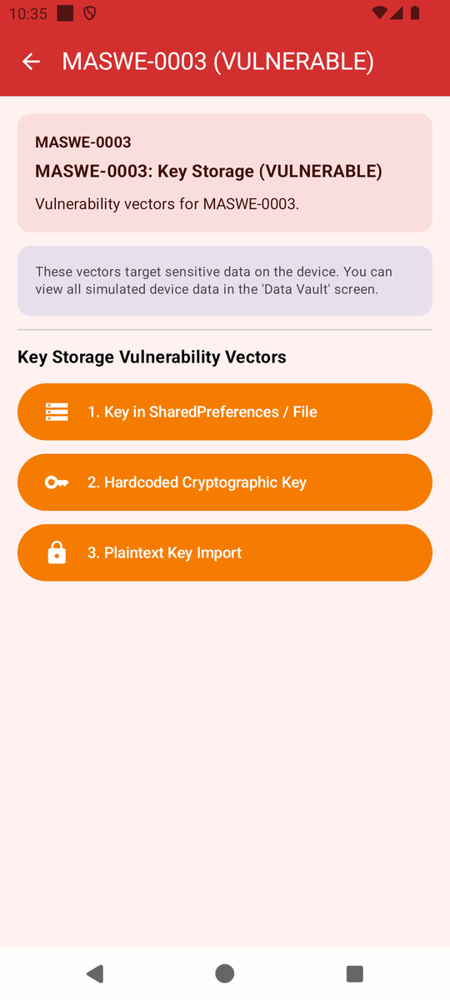
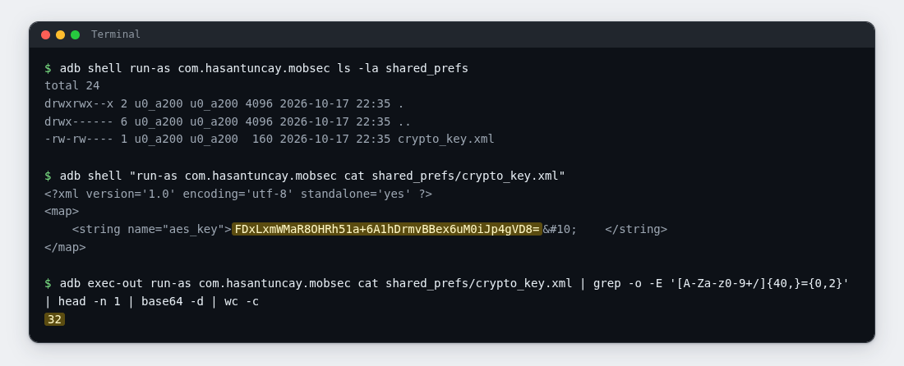
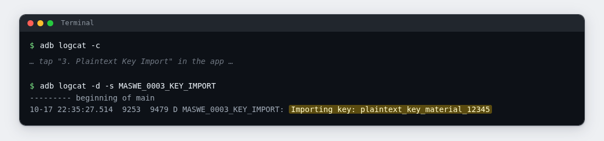

# Lab 03: The Spare Key Under the Mat

| | |
|---|---|
| **Module** | [MASWE-0003: Cryptographic Keys Stored Outside of Platform Keystore](../maswe/MASVS-STORAGE/maswe_003/MASWE-0003-Insecure-Key-Storage.md) |
| **Category** | MASVS-STORAGE · MASVS-CRYPTO |
| **CWE** | CWE-312: Cleartext Storage of Sensitive Information |
| **Time** | ~25 minutes |
| **Level** | Beginner |
| **Needs** | [Lab rules](index.md#before-you-conduct-any-lab) read · [Lab 00: Setup](setup.md) complete · **🎯 MobSec Victim** installed · `adb` working |

!!! info "Self-paced lab"
    Use the demo buttons to generate and import key material, then inspect the resulting files and logs. Section E lists the evidence to submit.

---

## A · Requirement

The app should use the Android Keystore to protect its cryptographic keys. The app can request operations with a Keystore key without reading or exporting the key bytes. Raw keys should not appear in preferences files or logs.

Inspect the two locations used by this app and check whether they contain key bytes or a reference to a protected key. Explain what an attacker could do with the material you recover.

Do not read the project source code. Use the installed app and your terminal.

---

## B · Validation

Run everything in one terminal (Git Bash on Windows). Capture the command output rather than the app's result cards.

### 1. Look before

```bash
adb shell run-as com.hasantuncay.mobsec ls -la shared_prefs
```

Expected: a short listing, or `No such file or directory` if this is your first storage lab. Save the output to compare with step 3.

### 2. Make the app store its key

Open **🎯 MobSec Victim**, expand `MASVS-STORAGE`, and open the `MASWE-0003` row.

!!! note "Incorrect dashboard subtitle"
    The row subtitle may read something with SECURE in it. That is a bug in this training build. The screen title bar is what counts: `MASWE-0003 (VULNERABLE)`.

The module lists three vectors. This lab needs the first and the third:

{ width="380" }

!!! warning "Inspect the output before reading the result cards"
    After each tap the card prints the path or the log command you are meant to find. Treat it as a spoiler: run your own commands first, and read the card only if you are stuck.

Tap the first button: `1. Key in SharedPreferences / File`.

### 3. Look again

```bash
adb shell run-as com.hasantuncay.mobsec ls -la shared_prefs
```

Expected: a new SharedPreferences file named `crypto_key.xml`.

### 4. Read the stored key

```bash
adb shell "run-as com.hasantuncay.mobsec cat shared_prefs/crypto_key.xml"
```

Expected: a small XML file with one entry, `<string name="aes_key">` followed by a base64 value. The value sits on one line, and a trailing encoded newline (`&#10;`) and spaces can follow inside the element; the next command handles that. The app generated an AES key and wrote the encoded bytes straight to disk. The write is asynchronous, so if the entry is missing, wait a second and read again.

### 5. Decode and count the key bytes

Decode the stored value and check its length:

```bash
adb exec-out run-as com.hasantuncay.mobsec cat shared_prefs/crypto_key.xml | grep -o -E '[A-Za-z0-9+/]{40,}={0,2}' | head -n 1 | base64 -d | wc -c
```

The `grep` pulls the base64 run out of the XML, the decoder turns it back into bytes, and `wc -c` counts them.

Expected: `32`, the byte length of an AES-256 key. The app stored the encoded key bytes, so a reader can decode and use them.



### 6. Inspect the imported key in the log

Clear earlier log entries before running the import:

```bash
adb logcat -c
```

Now go back to the module screen and tap the third button: `3. Plaintext Key Import`.

Then dump the log:

```bash
adb logcat -d -s MASWE_0003_KEY_IMPORT
```

Expected: a line reading `Importing key: ` followed by a plain, readable string. That is key material written into the system log for anyone with log access to find. If the dump is empty, tap the button again and rerun the command immediately.



### 7. Optional: let the project's checker confirm it

If you have the project repository on this machine, the module ships a script that repeats both reads:

```bash
bash features/maswe0003/poc/adb_verify.sh
```

Expected: `[!] CRITICAL VULNERABILITY CONFIRMED (MASWE-0003 / CWE-312):` followed by the key file it could read (with its decoded byte length) and the log line it found.

---

## C · Questions

Answer these in your notes before moving on:

1. ✍️ The AES key existed as 32 readable bytes in a file. Where do app keys normally live on Android, and what is different about them there?
2. ✍️ The log line is one `adb` command away while a device is attached for debugging. Name one more way log lines leave a device in normal operation.
3. ✍️ With the key from step 4 in hand, what can an attacker do that they could not do without it? Name one concrete action.

---

## D · Finding

You have the finding when all four are true:

| Test | What it shows |
|---|---|
| The step 3 listing | A preferences file appeared minutes after the app generated a key |
| The step 4 output | The file holds a full base64 copy of the AES key, in the clear |
| The step 5 output | The copy decodes to 32 bytes of raw key material, ready to use |
| The step 6 output | More key material landed in the system log, readable with one command |

If you ran step 7, its output is a second, independent confirmation of the same artifacts. Attach it as well.

---

## E · Evidence

Hand in:

1. 📷 Screenshot 1: your terminal with the step 4 XML output and the step 5 `32` result on screen.
2. 📷 Screenshot 2: the step 6 log line.
3. ✍️ Two or three sentences, in your own words:
   - where the two copies of key material ended up,
   - what the Keystore would have done differently,
   - one concrete thing an attacker could do with a copied key.

Submit these through your training channel. No long report is needed.

---

## F · Hints

??? question "Hint 1: run-as or the file read fails"
    - `run-as: package not debuggable` means the release build is installed. Reinstall the debug APK from Lab 00.
    - `No such file or directory` for `shared_prefs` means the button has not run yet. Tap `1. Key in SharedPreferences / File` and list again.

??? question "Hint 2: the XML is there but the entry looks odd"
    - The write is asynchronous. Wait one second, then `cat` again.
    - The value is base64, so it can contain `+`, `/`, and `=`. Copy it whole if you want to decode it by hand.
    - If you are on macOS instead of Git Bash, `base64 -d` may need to be `base64 -D`.

??? question "Hint 3: the logcat dump is empty"
    - Clear the buffer first (`adb logcat -c`), tap the third button, then dump immediately. Busy emulators rotate the buffer quickly.
    - The tag is exact: `MASWE_0003_KEY_IMPORT`, with underscores.
    - Still empty, try without the filter: `adb logcat -d | grep MASWE_0003`.

---

## G · Explanation

!!! warning "Open only after sections C and E are done"
    Complete your answers and capture your evidence before opening the explanation.

??? question "Why the key left copies behind"
    This is **MASWE-0003**, covering **CWE-312** (cleartext storage) and **CWE-321** (hardcoded cryptographic key).

    Vector 1 generated a fresh AES-256 key, encoded it with `Base64.DEFAULT`, and stored it in `shared_prefs/crypto_key.xml` under the name `aes_key`. Base64 encoding leaves the key recoverable by anyone who can read the file. Vector 3 passed key material to `Log.d`, exposing it to debugging sessions, bug reports, and logging pipelines.

    Vector 2 hardcodes a key as a byte array in the app's bytecode. This copy ships in the app package and can be recovered with tools such as jadx or apktool.

    Why it matters:

    - A device image can expose the preferences key, collected logs can expose the imported key, and the APK contains the hardcoded key from vector 2.
    - Keys outside the Keystore lose the hardware protections: attestation, non-exportability, and the option to require user authentication.
    - Rotating the app's key does not remove copies already collected from files, logs, or packages.

    What the secure app does instead:

    The `:app-secure` implementation generates its keys inside the Android Keystore (`KeyGenerator.getInstance(KEY_ALGORITHM_AES, "AndroidKeyStore")`), with StrongBox preferred where the hardware offers it, and nothing is written to preferences or logs. For keys that must arrive from a server, it points at Keystore wrapped key import instead of shipping raw material.

    Go deeper:

    - Reference page: [MASWE-0003: Cryptographic Keys Stored Outside of Platform Keystore](../maswe/MASVS-STORAGE/maswe_003/MASWE-0003-Insecure-Key-Storage.md)
    - The vulnerable code lives in `features/maswe0003/src/main/java/com/hasantuncay/mobsec/maswe0003/vulnerable/Maswe0003VulnerableRepository.kt`.
    - The module's automation is in `features/maswe0003/poc/`: a Semgrep rule pack for CI, a Frida hook for runtime inspection, and the `adb` script from step 7.
