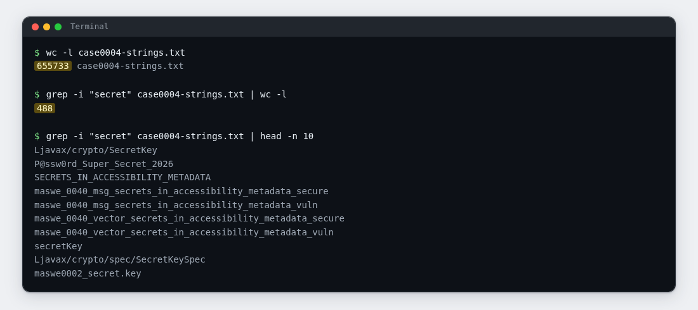

# Lab 04: The Key That Never Left the Office

| | |
|---|---|
| **Module** | [MASWE-0004: Sensitive Data Hardcoded in the App Package](../maswe/MASVS-STORAGE/maswe_004/MASWE-0004-Hardcoded-Secrets.md) |
| **Category** | MASVS-STORAGE · MASVS-CRYPTO |
| **CWE** | CWE-798: Use of Hard-coded Credentials |
| **Time** | ~25 minutes |
| **Level** | Beginner |
| **Needs** | [Lab rules](index.md#before-you-conduct-any-lab) read · [Lab 00: Setup](setup.md) complete · **🎯 MobSec Victim** installed · `adb` working |

!!! info "Self-paced lab"
    Inspect the installed APK for a payment secret. You can complete this lab without opening the app or reading its source code. Section E lists what to submit.

---

## A · Requirement

The app should not contain a reusable backend secret in its package. Anyone who obtains the APK can inspect its contents. Access credentials should be obtained at runtime, with a limited lifetime.

Pull the app off your emulator and look through the package with your own commands. Recover the payment secret, then explain in your own words what an attacker could do with it.

You do not need to open the app on the emulator for these checks.

Do not read the project source code. Work from the installed package.

---

## B · Validation

Run everything in one terminal (Git Bash on Windows) and one folder that you choose.

### 1. Find the app file on the device

```bash
adb shell pm path com.hasantuncay.mobsec
```

Expected: one or more lines that start with `package:` and end in `.apk`. If the app was installed as a split APK, use the line that ends in `base.apk`. Copy everything after `package:`.

### 2. Copy the app file to your machine

```bash
adb pull <the path from step 1> case0004.apk
```

Expected: `1 file pulled`.

!!! note "No root needed"
    The installed app file is readable by the `shell` user, so this lab works on any emulator, rooted or not.

### 3. Unpack the app file

An APK is a ZIP archive. Unpack it:

```bash
unzip -o case0004.apk -d case0004
ls case0004
```

Expected: a listing with `AndroidManifest.xml`, `resources.arsc`, and one or more `classes.dex` files. The app's code compiles into the `classes*.dex` files.

!!! tip "Windows without `unzip`"
    If Git Bash says `unzip: command not found`, rename `case0004.apk` to `case0004.zip`, extract it with Windows Explorer into a folder named `case0004`, and continue with step 4.

### 4. Turn the compiled code into readable text

The dex file is binary, but the strings inside it are plain text. Extract the readable runs:

```bash
grep -a -h -o -E "[A-Za-z][A-Za-z0-9_./:?&=%+@#-]{7,}" case0004/classes*.dex > case0004-strings.txt
wc -l case0004-strings.txt
```

`-a` tells grep to read the binary file as text, `-o` prints only the matched words, and `-h` hides file names. The pattern keeps every run that starts with a letter and is at least eight characters long.

Expected: `wc -l` prints a large number. The build used to verify this lab produced about 655,000 lines. The pattern can include unrelated characters at the ends of strings; check these when copying a candidate value.

### 5. Search for the payment secret

Search the extracted strings for candidate secret names and values:

```bash
grep -i "secret" case0004-strings.txt
```

Expected: a long list. The build used to verify this lab printed 488 hits, mostly identifiers from the bundled Tink and BouncyCastle libraries. Pipe the command into `less` to page through it, or add `| head -n 40` for an initial sample. The payment-secret name and value are near the bottom of the full list.



Look for an uppercase name referring to a payment secret and a long value that resembles a generated key.

Record the name and value in your notes. You may include other suspected leaks in your description, but the required finding is the payment secret.

### 6. Prove the value ships inside the code

Search for the exact value from step 5 to identify the dex file containing it:

```bash
grep -a -l "<the value you copied>" case0004/classes*.dex
```

Expected: one or more file names, for example `case0004/classes.dex`. That file travels to every device the app is installed on. If grep prints nothing, the value got cut when you copied it. Copy it again, exactly.

### 7. Optional: let the project's checker confirm it

If you have the project repository on this machine, run the module's verification script from the repository root with your emulator connected:

```bash
bash features/maswe0004/poc/adb_verify.sh
```

It pulls the installed app again, scans it for known secret formats, and prints what it finds. You can also point it at the file you already have. Pass the path to your copy, because a bare file name only resolves from the folder that holds it:

```bash
bash features/maswe0004/poc/adb_verify.sh /path/to/case0004.apk
```

Expected: `[!] CRITICAL VULNERABILITY CONFIRMED (MASWE-0004 / CWE-798):` followed by the values it found, including the one you extracted by hand. The script may also flag other hardcoded leftovers in the app. Note anything it caught that your manual search missed.

---

## C · Questions

Answer these in your notes before moving on:

1. ✍️ What made you sure the value you picked was a secret, and not another variable name?
2. ✍️ Which file inside the package carried it, and why does that file end up on every device that installs the app?
3. ✍️ What can an attacker do with the value once they have it? Name one concrete action.

---

## D · Finding

You have the finding when all three are true:

| Test | What it shows |
|---|---|
| The keyword search in step 5 | The name and the value, found by your own command |
| The exact-value grep in step 6 | The same value is a literal string inside `classes*.dex`, the code that ships to every user |
| Section C, question 3 | One sentence of impact: what an attacker does with the value |

If you ran step 7, its output is a second, independent confirmation of the same value. Attach it as well.

---

## E · Evidence

Hand in:

1. 📷 Screenshot 1: your terminal with the step 5 command and its hit visible. The name and the full value must be readable; scroll or zoom so neither is cut off.
2. 📷 Screenshot 2: the step 6 output, or the step 7 script output if you ran it. One of them must tie the value to a file inside `case0004/`.
3. ✍️ Two or three sentences, in your own words:
   - what the secret is,
   - where it lived in the package,
   - one concrete thing an attacker could do with it.

Submit these through your training channel. No long report is needed.

---

## F · Hints

??? question "Hint 1: step 1 or 2 fails"
    - Copy the path exactly as printed, without the `package:` prefix and without surrounding quotes.
    - If `pm path` prints several lines (split APKs), use the line that ends in `base.apk`.
    - If `adb pull` says `remote object does not exist`, run step 1 again. The path changes after an app update.

??? question "Hint 2: step 3 or 4 fails"
    - `unzip: command not found`: use the Windows Explorer workaround in step 3.
    - The strings file ends up empty: check that `ls case0004` lists at least one `classes*.dex` file, and that you are in the folder where you ran step 2.
    - The grep flags in step 4 need Git Bash or any Linux or macOS shell. PowerShell is a different tool and will not run the command as written.

??? question "Hint 3: step 5 is noisy or confusing"
    - Rerun step 4 if `wc -l case0004-strings.txt` did not print a large number.
    - Lines that start with `L` are library type names. Skip them.
    - The pair you want is one name in capitals and one long value with underscores and digits. The requirement mentions payment, so one of the names should mention it too.
    - To shrink the list without reading all of it: `grep -i "secret" case0004-strings.txt | grep -i payment`.

---

## G · Explanation

!!! warning "Open only after sections C and E are done"
    Complete your answers and capture your evidence before opening the explanation.

??? question "Why the secret was in the package"
    This is **CWE-798: Use of Hard-coded Credentials**.

    The payment secret is a `const val` in the vulnerable repository class (`Maswe0004VulnerableRepository`). The compiler embedded its characters in `classes.dex` as plain text, which is why a keyword search on the shipped file recovered it. Neither a decompiler nor root access was needed.

    Why it matters:

    - Anyone who installs or downloads the app can extract the unencrypted value with common tools.
    - A leaked payment secret can lead to fraud or account takeover, depending on what it unlocks.
    - Replacing the hardcoded value requires a new build. Existing APKs still contain the old value.
    - The module demonstrates three more hardcoding habits: secrets in `strings.xml` or assets, secrets in third-party SDK configuration, and staging endpoints left in release builds.

    What the secure app does instead:

    The `:app-secure` implementation fetches short-lived tokens from a backend at runtime and keeps them in memory. It does not embed the backend secret in the package.

    Go deeper:

    - Reference page: [MASWE-0004: Sensitive Data Hardcoded in the App Package](../maswe/MASVS-STORAGE/maswe_004/MASWE-0004-Hardcoded-Secrets.md)
    - The repository's automation for this module lives in `features/maswe0004/poc/`: a Semgrep rule for CI scanning, a Frida hook for runtime inspection, and the `adb` script from step 7.
