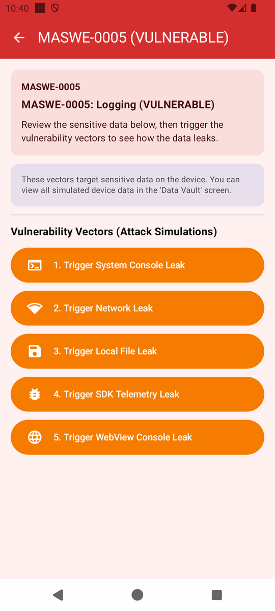
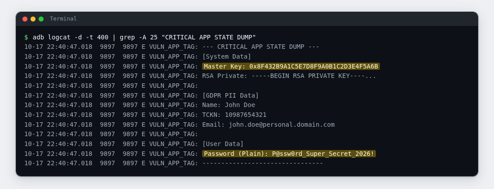
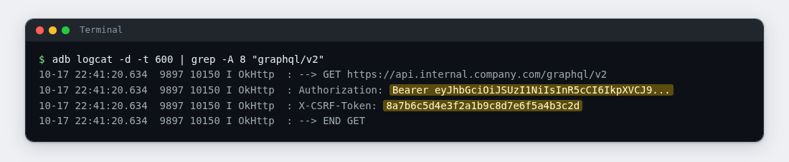
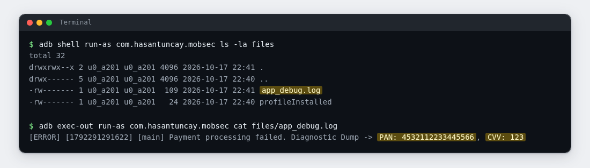

# Lab 05: What the Logs Remember

| | |
|---|---|
| **Module** | [MASWE-0005: Sensitive Data Leakage via Logging](../maswe/MASVS-STORAGE/maswe_005/MASWE-0005-Logging-Leaks.md) |
| **Category** | MASVS-STORAGE |
| **CWE** | CWE-532: Insertion of Sensitive Information into Log File |
| **Time** | ~30 minutes |
| **Level** | Beginner |
| **Needs** | [Lab rules](index.md#before-you-conduct-any-lab) read · [Lab 00: Setup](setup.md) complete · **🎯 MobSec Victim** installed · `adb` working |

!!! info "Self-paced lab"
    Inspect the system log, network request logging, and a local log file for sensitive values. Use the demo buttons to produce the output and your terminal to collect it. Section E lists what to submit.

---

## A · Requirement

The app should keep credentials, cryptographic keys, and sensitive personal data out of logs. Debugging tools and crash-reporting services can collect those logs, including through bug reports, so a logged value may be copied beyond the app.

Run the first three demonstrations and inspect each output. Identify the sensitive values and explain how someone with access to the logs could use them.

Do not read the project source code. Use the installed app and your terminal.

---

## B · Validation

Run everything in one terminal (Git Bash on Windows). Inspect the outputs before reading the app's result cards.

### 1. Clear the log buffer

Clear entries from earlier labs before generating the test output:

```bash
adb logcat -c
```

Expected: no output. The device's log buffer is now empty.

### 2. Make the app dump its state

Open **🎯 MobSec Victim**, expand `MASVS-STORAGE`, and open the `MASWE-0005` row.

!!! note "Incorrect dashboard subtitle"
    The row subtitle reads `MASWE-0005: Logging (SECURE)`. That is a bug in this training build. The screen title bar is what counts: `MASWE-0005 (VULNERABLE)`.

The module lists five vectors. This lab uses the first three; the last two belong to the SDK and WebView sinks covered in the reference page.

{ width="380" }

Tap the first button: `1. Trigger System Console Leak`. If a toast complains about a missing attacker app, ignore it; it repeats on every tap, and the leak happens regardless.

### 3. Inspect the recent log entries

```bash
adb logcat -d -t 400 | tail -n 80
```

Expected: emulator messages and a block of app output marked with a banner. Locate that block in the recent entries.

### 4. Pull the block out cleanly

Once you have seen the banner, print exactly that block:

```bash
adb logcat -d -t 400 | grep -A 25 "CRITICAL APP STATE DUMP"
```

Expected: the full app-state dump, including device data, personal identifiers, a password, and key material. Record at least two sensitive values and explain what access each could give an attacker.



### 5. Inspect the network request log

Go back to the module and tap the second button: `2. Trigger Network Leak`. The demonstration uses a non-working endpoint, so a request failure is expected. Inspect what the network logger wrote before the connection attempt:

```bash
adb logcat -d -t 600 | grep -A 8 "graphql/v2"
```

Expected: the outgoing request line, followed by its headers. One header starts with `Authorization: Bearer ` and carries a signed token; another carries a CSRF token. A network library printed both because the app enabled full-body logging. The block ends with `--> END GET`; the failed connection (`<-- HTTP FAILED`) follows a moment later.



!!! tip "If the grep finds nothing"
    Some logcat versions move these lines around. Try `adb logcat -d -t 600 | grep -i okhttp`, then look at the lines around the request.

### 6. Read the local log file

Tap the third button: `3. Trigger Local File Leak`. This demonstration writes to a local file instead of logcat:

```bash
adb shell run-as com.hasantuncay.mobsec ls -la files
adb exec-out run-as com.hasantuncay.mobsec cat files/app_debug.log
```

Expected: a file named `app_debug.log`, and inside it a line beginning `[ERROR]` that ends with `PAN: `, a card number, and `CVV: `, a three-digit code. The file is plaintext and grows with every tap; the app never deletes it.



### 7. Optional: let the project's checker confirm it

If you have the project repository on this machine, the module ships a script that repeats these three reads:

```bash
bash features/maswe0005/poc/adb_verify.sh
```

Expected: `[!] CRITICAL VULNERABILITY CONFIRMED (MASWE-0005 / CWE-532):` followed by the credential line it found in logcat, the token line from the network request, and the payment line from `app_debug.log`.

---

## C · Questions

Answer these in your notes before moving on:

1. ✍️ The dump contained a password, key material, and personal identifiers. Who or what could collect these values from the log? Compare that access with a file inside the app's private storage.
2. ✍️ The network request never succeeded, yet its `Authorization` header is on record. What does that tell you about logging interceptors?
3. ✍️ `app_debug.log` is append-only and never cleaned up. What does that mean for the secrets in it over the life of the install?

---

## D · Finding

You have the finding when all four are true:

| Test | What it shows |
|---|---|
| The step 4 output | A full app-state dump in the system log, with at least two sensitive values readable |
| The step 5 output | A bearer token and CSRF token printed by a network logger before the connection attempt |
| The step 6 output | Card data written to a plaintext file that is never deleted |
| Section C, questions 1 to 3 | Your explanation of why each sink leaves the app's trust boundary |

If you ran step 7, its output is a second, independent confirmation of the same three artifacts. Attach it as well.

---

## E · Evidence

Hand in:

1. 📷 Screenshot 1: your terminal showing the step 4 dump. The password line (or another clearly sensitive line) must be readable.
2. 📷 Screenshot 2: your strongest of the two other finds: the step 5 network headers or the step 6 file line.
3. ✍️ Two or three sentences, in your own words:
   - which sensitive values ended up in which sink,
   - how logging makes those values available outside the app,
   - one concrete thing someone with access to the dump could do with it.

Submit these through your training channel. No long report is needed.

---

## F · Hints

??? question "Hint 1: the log looks empty or the tap did nothing"
    - Tap the vector again and dump immediately. Busy emulators rotate the buffer quickly.
    - A toast about the "attacker app" is expected and harmless. The leak does not depend on it.
    - Verify the tag in your output first; every line carries one. It starts with `VULN_`.

??? question "Hint 2: the network grep finds nothing"
    - The result card says `VULN_NETWORK`, but the library prints under `OkHttp`. Run `adb logcat -d -t 800 | grep -i -E "okhttp|Bearer|graphql"`.
    - The endpoint string is `api.internal.company.com`; search for that instead of the path.
    - Lines may have scrolled out; tap the button again and repeat within a few seconds.

??? question "Hint 3: the file read fails"
    - `run-as` needs the debug build from Lab 00. A release build answers `package not debuggable`.
    - The file is appended per tap, so tap the button once more, then `ls -la files` to confirm the name.
    - Copying the line by hand? The number runs to 16 digits; do not cut it short.

---

## G · Explanation

!!! warning "Open only after sections C and E are done"
    Complete your answers and capture your evidence before opening the explanation.

??? question "What each vector gives away"
    MASWE-0005 covers CWE-532: Insertion of Sensitive Information into Log File.

    Vector 1 built a multi-line string with a master key, part of an RSA private key, a full name, a national identification number, an email, and a plaintext password, and handed it to `Log.e`. Once written, the dump is ordinary log text: readable over adb, copied into bug reports, harvested by any log-collecting pipeline on the device.

    Vector 2 sets the OkHttp `HttpLoggingInterceptor` to `Level.BODY`. It prints the outgoing request line and headers, including `Authorization: Bearer ...` and the CSRF token, before attempting the connection. The credentials therefore appear in the log even when the request fails.

    Vector 3 writes a payment failure line with a full card number and CVV to `app_debug.log` in the app's private files. The file is plaintext and never rotated or deleted, so the card data piles up for the life of the install.

    Why it matters:

    - Logs cross the app's trust boundary by design: crash reporters, remote logging SDKs, bug reports, and support tooling all read them.
    - A multi-line dump like this one gets copied into bug reports and log pipelines, and those copies outlive the debugging session that produced it.
    - The class in this module covers five sinks in total: the system console, the network stack, a local file, a third-party SDK payload (which logs PII, clipboard content, and message drafts), and a WebView console bridge.

    What the secure app does instead:

    The `:app-secure` implementation has a remote kill switch for logging and restricts debug messages to debug builds. It sets the network logger to `Level.NONE` and uses a redacting interceptor. Diagnostics are encrypted, card numbers are masked, and CVVs are omitted. It replaces raw PII with a salted PBKDF2 hash and forwards only whitelisted WebView console messages.

    Go deeper:

    - Reference page: [MASWE-0005: Sensitive Data Leakage via Logging](../maswe/MASVS-STORAGE/maswe_005/MASWE-0005-Logging-Leaks.md)
    - The vulnerable code lives in `features/maswe0005/src/main/java/com/hasantuncay/mobsec/maswe0005/vulnerable/Maswe0005VulnerableRepository.kt`.
    - The module's automation is in `features/maswe0005/poc/`: a Semgrep rule pack for CI, a Frida hook for runtime inspection, and the `adb` script from step 7.
