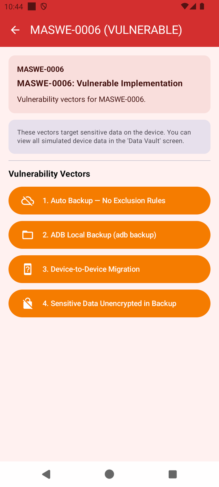
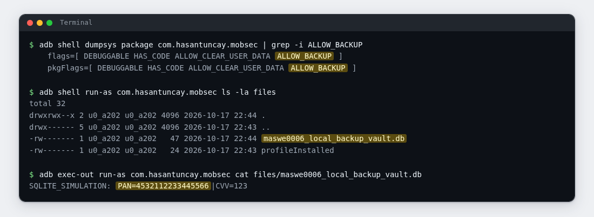
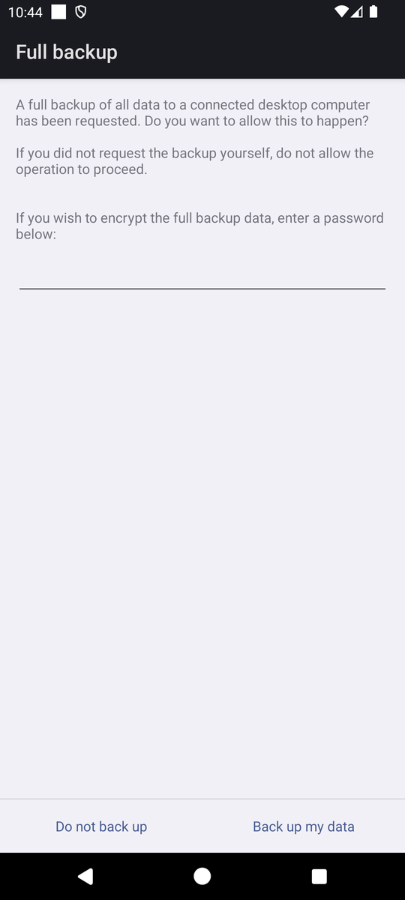
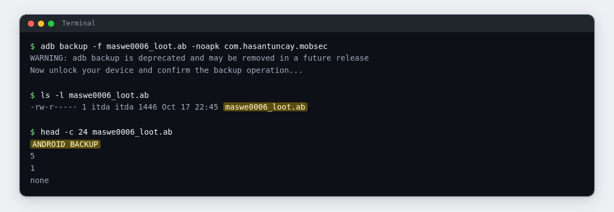

# Lab 06: The Backup That Took Everything

| | |
|---|---|
| **Module** | [MASWE-0006: Sensitive Data Not Excluded From Backup](../maswe/MASVS-STORAGE/maswe_006/MASWE-0006-Sensitive-Data-Backup.md) |
| **Category** | MASVS-STORAGE |
| **CWE** | CWE-200: Exposure of Sensitive Information to an Unauthorized Actor |
| **Time** | ~30 minutes |
| **Level** | Beginner |
| **Needs** | [Lab rules](index.md#before-you-conduct-any-lab) read · [Lab 00: Setup](setup.md) complete · **🎯 MobSec Victim** installed · `adb` working |

!!! info "Self-paced lab"
    Check whether the installed app allows backups and which sensitive files are in scope. You will also try a local backup; the result depends on your Android image. Section E lists what to submit.

---

## A · Requirement

The app should exclude sensitive files from cloud backups and device-to-device transfers. Backup settings include a manifest flag and rules for individual files. These need to protect the data even when a backup runs without the app open.

Check the installed package's backup flag, then run the demonstrations and inspect the files they create in backup locations. Record the sensitive values and the result of the local backup attempt.

Do not read the project source code. Use the installed app and your terminal.

---

## B · Validation

Run everything in one terminal (Git Bash on Windows). Ignore the app's result cards and work from the commands on this page.

### 1. Check the installed package's backup flag

Android tracks whether an app is in scope for backup as a flag on the installed package:

```bash
adb shell dumpsys package com.hasantuncay.mobsec | grep -i ALLOW_BACKUP
```

Expected: one or two lines of the form `flags=[ HAS_CODE ALLOW_CLEAR_USER_DATA ALLOW_BACKUP ... ]` inside the package's dump; newer images print a matching `pkgFlags=[ ... ]` line as well. The other flags vary by build; the token `ALLOW_BACKUP` is the part that matters here. No app interaction is needed to see it.

### 2. Open the module

Open **🎯 MobSec Victim**, expand `MASVS-STORAGE`, and open the `MASWE-0006` row.

!!! note "Incorrect dashboard subtitle"
    The row subtitle reads `MASWE-0006: Secure Implementation`. That is a bug in this training build. The screen title bar is what counts: `MASWE-0006 (VULNERABLE)`.

The module lists four vectors. This lab taps three of them, in this order: the ADB backup vector, the migration vector, and the cloud backup vector. The fourth is covered in section G.

{ width="380" }

### 3. The file the ADB backup vector leaves

Tap the second button: `2. ADB Local Backup (adb backup)`. Then find what it wrote:

```bash
adb shell run-as com.hasantuncay.mobsec ls -la files
adb exec-out run-as com.hasantuncay.mobsec cat files/maswe0006_local_backup_vault.db
```

Expected: a new file `maswe0006_local_backup_vault.db`, and inside it one line reading `SQLITE_SIMULATION: PAN=`, a 16-digit card number, a pipe character, then `CVV: ` and three digits.



!!! tip "The `.db` file is not a database"
    This demonstration writes a single plaintext line to a file with a `.db` extension. Read it with `cat`; a SQLite browser cannot open it as a database.

### 4. The file the migration vector leaves

Tap the third button: `3. Device-to-Device Migration`. Then:

```bash
adb exec-out run-as com.hasantuncay.mobsec cat files/maswe0006_migration_credentials.json
```

Expected: a JSON object with two keys. `refreshToken` holds a base64 value, and `masterKey` holds a value starting with `0x`. Both are credentials that should be excluded from the migration.

### 5. The file the cloud backup vector leaves

Tap the first button: `1. Auto Backup — No Exclusion Rules`. This one writes to preferences, so list that folder first:

```bash
adb shell run-as com.hasantuncay.mobsec ls -la shared_prefs
adb shell "run-as com.hasantuncay.mobsec cat shared_prefs/maswe0006_cloud_backup_session.xml"
```

Expected: a file named `maswe0006_cloud_backup_session.xml` with two entries, `auth_token` (the JWT-looking value again) and `user_email`, a personal email address in plain text. The write is asynchronous, so if the entry is missing, wait a second and read again.

### 6. Attempt a local backup

Try creating an archive with the platform's backup command:

```bash
adb backup -f maswe0006_loot.ab -noapk com.hasantuncay.mobsec
```

A dialog appears on the emulator asking to back up your data. Confirm it (no password needed):

{ width="380" }

Two outcomes are normal:

- **An archive appears.** Check it with `ls -l maswe0006_loot.ab`. The first bytes are readable: `head -c 24 maswe0006_loot.ab` prints `ANDROID BACKUP`, which is the format's magic string. You now hold the app's data on your laptop.
- **The platform refuses.** On many Android 12 and newer images, `adb backup` answers `Backup disabled` or returns an empty file. Record that outcome and continue. Steps 1 through 5 still document the backup flag and sensitive files; this refusal limits what you can demonstrate about local extraction on this image.



### 7. Optional: let the project's checker confirm it

If you have the project repository on this machine, the module ships a script that repeats the flag check and all four file reads:

```bash
bash features/maswe0006/poc/adb_verify.sh
```

Expected: `[!] CRITICAL VULNERABILITY CONFIRMED (MASWE-0006 / CWE-200):` followed by the backup flag line, the card data line, the session keys line, and a note about the token and email in preferences. The script prints a bullet for each of the four files it finds in backup scope; it also reads the fourth vector's customer-records file, so tapping that vector adds a line to the report.

---

## C · Questions

Answer these in your notes before moving on:

1. ✍️ With the `dumpsys` backup flag enabled and no exclusion rules, which backup or transfer channels can copy this app's stored data? Note any platform restrictions you observed.
2. ✍️ Two files are named `.db` and `.sqlite`, and a result card promised a database browser would open them. What is really inside, based on your own output?
3. ✍️ A backup is made by the user and belongs to the user. Explain why the app should still keep card data out of the archive.

---

## D · Finding

You have the finding when all four are true:

| Test | What it shows |
|---|---|
| The step 1 output | The platform has the app flagged as backup-eligible, with no special handling visible in the dump |
| The steps 3 to 5 outputs | Card data, session keys, and a personal email sit in plaintext inside `files/` and `shared_prefs/`, the standard backup scope |
| The step 6 outcome | Whether local extraction produced an archive with `ANDROID BACKUP` in its header or was refused; distinguish this result from the flag and file checks |
| Section C, questions 1 to 3 | Your explanation of the channels and the impact |

If you ran step 7, its output is a second, independent confirmation of the same artifacts. Attach it as well.

---

## E · Evidence

Hand in:

1. 📷 Screenshot 1: the step 1 `ALLOW_BACKUP` line, plus the file listing from step 3.
2. 📷 Screenshot 2: the card data line from step 3 and at least one more file read (step 4 or 5).
3. 📷 Screenshot 3 (only if your image produced an archive): `ls -l` and the `ANDROID BACKUP` header.
4. ✍️ Two or three sentences, in your own words:
   - which switch is on and which rules are missing,
   - which sensitive files are in the backup scope,
   - one concrete way an attacker reaches a backup that the user never noticed.

Submit these through your training channel. No long report is needed.

---

## F · Hints

??? question "Hint 1: the dumpsys grep prints nothing"
    - Older images label the field `pkgFlags=`. Try `adb shell dumpsys package com.hasantuncay.mobsec | grep -i flags` and read the lines.
    - If there is no output at all, confirm the app is installed: `adb shell pm list packages | grep mobsec`.
    - Reading the flag needs no root and no app interaction. If it fails, the package name is wrong.

??? question "Hint 2: a file is missing or the folder looks different"
    - Vector 1 writes preferences asynchronously; wait a second and list again.
    - `shared_prefs` and `files` also hold other modules' artifacts. Look for the exact names: `maswe0006_cloud_backup_session.xml`, `maswe0006_local_backup_vault.db`, `maswe0006_migration_credentials.json`, `maswe0006_unencrypted_customer_records.sqlite`.
    - `run-as: package not debuggable` means the release build is installed. Reinstall the debug APK from Lab 00.

??? question "Hint 3: the adb backup step misbehaves"
    - The on-device dialog must be confirmed. If no dialog appears, the image has the backup service disabled; that is the refusal case described in step 6.
    - If you got an archive and want to look inside, this trick often works in Git Bash:
      `( printf "\x1f\x8b\x08\x00\x00\x00\x00\x00" ; tail -c +25 maswe0006_loot.ab ) | tar -ztvf - | head -n 30`
      It may print warnings and exits nonzero after the list, because the truncated stream is expected; your app's file names above the error are the result. If nothing lists, the archive header and size remain your evidence.
    - Keep any output file and record its size, even if the backup failed. Include the refusal message in your notes.

---

## G · Explanation

!!! warning "Open only after sections C and E are done"
    Complete your answers and capture your evidence before opening the explanation.

??? question "Why the backup scope was wide"
    This is **MASWE-0006**, covering **CWE-200** (information exposure) with **CWE-312** roots.

    The manifest declares `android:allowBackup="true"` and points at the stock AOSP rule files, `backup_rules.xml` and `data_extraction_rules.xml`, with every include and exclude entry still commented out. Net effect: everything the app writes into `files/`, `shared_prefs/`, and its databases is in scope for cloud Auto Backup and device-to-device transfer, and `dumpsys` confirmed the flag on your emulator.

    The artifacts show what ended up in that scope. `maswe0006_local_backup_vault.db` holds `PAN=...|CVV=...` as a plain text line. `maswe0006_migration_credentials.json` holds a refresh token and a master key. `maswe0006_cloud_backup_session.xml` holds a bearer token and a personal email in preferences. A fourth vector (`4. Sensitive Data Unencrypted in Backup`) writes a customer record with a plaintext password to `maswe0006_unencrypted_customer_records.sqlite`.

    Why it matters:

    - Cloud Auto Backup runs without the app's involvement. A compromised cloud account can leak app data with no device access at all.
    - Device-to-device transfer can copy the stored credentials to a new phone unless the app excludes them.
    - Where supported, `adb backup` can copy app data to an attached laptop. Android 12 and newer restrict this path for normal apps (targetSdk 31 and up); that restriction does not replace the app's backup flag and exclusion rules.
    - Card data in any of these channels is also a PCI-DSS problem; the standard treats storage and backup together.

    What the secure app does instead:

    The `:app-secure` manifest sets `android:allowBackup="false"`, and its rule files explicitly exclude sensitive entries. The secure repository also encrypts its stored data with AES-256-GCM.

    Go deeper:

    - Reference page: [MASWE-0006: Sensitive Data Not Excluded From Backup](../maswe/MASVS-STORAGE/maswe_006/MASWE-0006-Sensitive-Data-Backup.md)
    - The vulnerable code lives in `features/maswe0006/src/main/java/com/hasantuncay/mobsec/maswe0006/vulnerable/Maswe0006VulnerableRepository.kt`.
    - The module's automation is in `features/maswe0006/poc/`: a Semgrep rule pack for CI, a Frida hook for runtime inspection, and the `adb` script from step 7.
