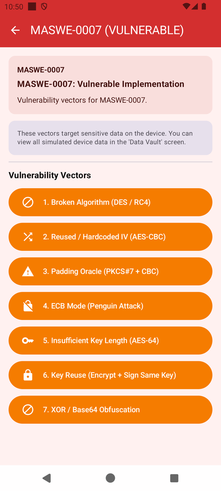
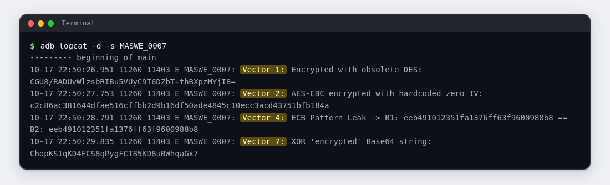
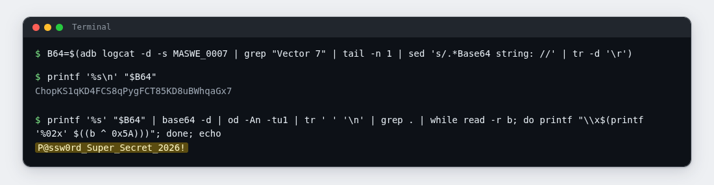
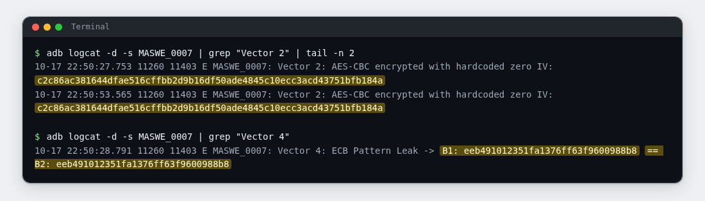

# Lab 07: Encryption in Name Only

| | |
|---|---|
| **Module** | [MASWE-0007: Improper Encryption](../maswe/MASVS-CRYPTO/maswe_007/MASWE-0007-Improper-Encryption.md) |
| **Category** | MASVS-CRYPTO |
| **CWE** | CWE-327: Use of a Broken or Risky Cryptographic Algorithm |
| **Time** | ~30 minutes |
| **Level** | Beginner |
| **Needs** | [Lab rules](index.md#before-you-conduct-any-lab) read · [Lab 00: Setup](setup.md) complete · **🎯 MobSec Victim** installed · `adb` working |

!!! info "Self-paced lab"
    Every button on this screen claims to encrypt something. Every one of those outputs lands in the system log, and the schemes behind them are weak enough that you peel three of them apart with one terminal line each. Section E tells you exactly what to capture as proof.

---

## A · Mission

Encryption is a promise: the output is useless to anyone without the key. This module breaks the promise: every ciphertext goes into the system log.

Your job: trigger the operations, collect what the app writes to the log, and break what can be broken. Finally you decode what the app calls encrypted text back into the original password, using nothing but your terminal.

Do not read the project source code. Use the installed app and your terminal.

---

## B · Steps

Run everything in one terminal (Git Bash on Windows). The app's result cards repeat what the demo was built to say; ignore them and build your evidence from your own `adb` output.

### 1. Clear the log and open the module

```bash
adb logcat -c
```

Open **🎯 MobSec Victim**, expand `MASVS-CRYPTO`, and open the `MASWE-0007` row.

!!! note "One label lies"
    The row subtitle reads `MASWE-0007: Secure Implementation`. That is a bug in this training build. The screen marks itself `MASWE-0007 (VULNERABLE)`.

### 2. Tap, then read what the app writes

Tap these four buttons, in any order:

- `1. Broken Algorithm (DES / RC4)`
- `2. Reused / Hardcoded IV (AES-CBC)`
- `4. ECB Mode (Penguin Attack)`
- `7. XOR / Base64 Obfuscation`

The module lists seven vectors; this lab uses the four above. Buttons 3, 5, and 6 are covered in the reveal.

{ width="380" }

Then dump the module's log stream:

```bash
adb logcat -d -s MASWE_0007
```

Expected: one line per tap, each starting `Vector N:`. Note the tag: `MASWE_0007`, with an underscore. The four lines hand you ciphertext in two encodings:

- Vector 1 prints a Base64 string for a DES operation.
- Vector 2 prints a hex string for an AES-CBC operation.
- Vector 4 prints two hex blocks joined by `B1: ... == B2: ...`.
- Vector 7 prints a Base64 string for its "XOR encryption".



The ciphertexts prove nothing on their own. Breaking them is the next three steps.

### 3. Break the first one: the XOR claim

Vector 7 is not encryption. It takes each byte of a secret, flips it with a single constant, and Base64-encodes the result: no key setup, no randomness. Undo it in two commands.

First, pull the Base64 string out of the log line into a shell variable:

```bash
B64=$(adb logcat -d -s MASWE_0007 | grep "Vector 7" | tail -n 1 | sed 's/.*Base64 string: //' | tr -d '\r')
printf '%s\n' "$B64"
```

You should see one clean Base64 string. Do not paste it into your report as-is; it is the thing you are about to break.

Now decode it and flip every byte back with the same constant, `0x5A`:

```bash
printf '%s' "$B64" | base64 -d | od -An -tu1 | tr ' ' '\n' | grep . | while read -r b; do printf "\\x$(printf '%02x' $((b ^ 0x5A)))"; done; echo
```

Expected: a readable string, the same kind of password this training app keeps in its data classes. You just recovered the original value from text the app called encrypted, without any key. Note in your own words that it worked; keep the string out of your report text and let the screenshot carry it.



!!! tip "Where does 0x5A come from?"
    One constant XOR is easy to lift from the app binary (Lab 04 skills apply), and it is also the only unknown in a 256-value search: try every byte until the output reads like text. A one-byte secret is not much to guess.

### 4. Break the second one: no randomness

Vector 2 claims AES-CBC, a real cipher. Look at what it actually produces. Tap `2. Reused / Hardcoded IV (AES-CBC)` a second time, then compare the two ciphertexts:

```bash
adb logcat -d -s MASWE_0007 | grep "Vector 2" | tail -n 2
```

Expected: two lines with the identical hex string. Same input, same output, every time. A sound scheme never does that: it mixes fresh random data (an IV or nonce) into every operation so that encrypting the same text twice looks completely different. Here the randomness is a hardcoded all-zero block, so equal plaintexts stay equal, and an attacker who sees two matching ciphertexts learns exactly which plaintexts matched.

### 5. Break the third one: structure survives

Vector 4 encrypts a text block that repeats itself and prints both halves:

```bash
adb logcat -d -s MASWE_0007 | grep "Vector 4"
```

Expected: a line of the form `Vector 4: ECB Pattern Leak -> B1: <hex> == B2: <hex>` in which the two hex strings are equal. ECB mode encrypts every 16-byte block on its own with no linking, so identical plaintext blocks become identical ciphertext blocks. This is the precondition for the famous ECB penguin picture: patterns in the plaintext stay visible in the ciphertext.



### 6. Optional: let the project's checker confirm it

If you have the project repository on this machine:

```bash
bash features/maswe0007/poc/adb_verify.sh
```

Expected: `[!] CRITICAL VULNERABILITY CONFIRMED (MASWE-0007 / CWE-327):` followed by the DES line, the zero-IV line, the ECB line, and a `recovered plaintext:` line that the script decoded itself. If vectors 3, 5, or 6 were also tapped, it adds a line naming what it captured.

---

## C · Look & tell

Answer these in your notes before moving on:

1. ✍️ In step 3 you held both the "encrypted" string and the original password, and you never saw a key. Write one sentence you would send a developer who called that operation encryption.
2. ✍️ In step 4, two encryptions of the same text produced the same output. Name the property a sound scheme is missing here, and one thing an attacker learns from the repeat.
3. ✍️ All four outputs you collected came from the system log. Which single practice would have kept this module's "ciphertext" out of your hands, even with its broken math?

---

## D · Prove it

You have the finding when all four are true:

| Test | What it shows |
|---|---|
| The step 2 dump | Four "encrypted" outputs, available to anyone reading the log |
| The step 3 output | The XOR/Base64 operation reversed to readable text with no key |
| The step 4 output | Two identical ciphertexts for repeated input: no randomness in the scheme |
| The step 5 output | Equal ciphertext blocks for equal plaintext blocks: ECB leaks structure |

If you ran step 6, its output is an independent confirmation of the same artifacts. Attach it as well.

---

## E · Your evidence

Hand in:

1. 📷 Screenshot 1: the step 2 dump, showing the four `Vector ...` lines.
2. 📷 Screenshot 2: the step 3 commands and their output, with the recovered string readable.
3. 📷 Screenshot 3: the step 4 comparison, the step 5 line, or both.
4. ✍️ Two or three sentences, in your own words:
   - which weaknesses you showed (a missing key, missing randomness, visible structure),
   - why "the output looks unreadable" is not the same claim as "the data is protected",
   - one real-world consequence of encrypting with a scheme like vector 7's.

Submit these through your training channel. No long report is needed.

---

## F · Stuck?

??? question "Hint 1: the log dump is empty"
    - The tag is `MASWE_0007` with an underscore. `-s MASWE-0007` matches nothing.
    - Tap a vector, then dump right away. Running `adb logcat -c` before your taps keeps the output short.
    - If `-s` gives you nothing at all, drop it and grep: `adb logcat -d | grep MASWE`.

??? question "Hint 2: the decode step misbehaves"
    - Check the extraction first: `printf '%s\n' "$B64"` must print one clean Base64 string with no spaces or log text around it. If it is empty, re-run the first command and confirm `Vector 7` appears in your dump.
    - On macOS, `base64 -d` is `base64 -D`; this lab assumes Git Bash.
    - If the output is garbage, your `od` may not support `-An` (without it, address offsets get mixed into the byte stream). A text-only fallback with Python: `printf '%s' "$B64" | python -c "import base64,sys;print(''.join(chr(b^0x5A) for b in base64.b64decode(sys.stdin.read().strip())))"`
    - If you want to skip being told the constant, loop over all 256 values and keep only the line that reads like text: `for k in $(seq 0 255); do printf '%s' "$B64" | base64 -d | od -An -tu1 | tr ' ' '\n' | grep . | while read -r b; do printf "\\x$(printf '%02x' $((b ^ k)))"; done; echo " <- k=$k"; done | grep "@"`

??? question "Hint 3: the script step"
    - Run it from the repository root; it needs `adb` on PATH and the module's vectors already tapped (at least 1, 2, 4, and 7).
    - If it reports nothing found, the log buffer rotated: tap the vectors again and rerun.
    - Exit code 0 means confirmed; 1 means nothing found yet.

---

## G · Reveal

!!! warning "Open only after sections C and E are done"
    Your screenshots are the evidence, not this section. Read it last.

??? question "What you actually found"
    This is **MASWE-0007**, covering **CWE-327** (broken algorithm) with **CWE-326** (inadequate strength), **CWE-329** (predictable IV), and **CWE-323** (key reuse) roots.

    The module ships seven demonstrations. What the code actually does, in the same order the buttons appear:

    1. DES with the key `insecure`, an eight-byte English word. DES has a 56-bit effective key; it belongs in a museum.
    2. AES-CBC with the key `1234567890123456` and an all-zero IV, so the output is a pure function of the input.
    3. AES-CBC with the key `FixedSecretKey12` and a constant IV, no authentication tag: the classic padding-oracle setup. The button advertises an oracle the demo never actually runs; the dangerous pattern is what it stands for.
    4. AES-ECB with the key `16ByteKeyForECB!` on a doubled 16-byte block, which is why your two blocks matched.
    5. DES again, with an eight-byte key of all `0x42`.
    6. One RSA-2048 pair used both to encrypt and to sign. It is generated fresh per tap, so what you saw is the anti-pattern, not a live key.
    7. XOR with `0x5A` plus Base64, the one you reversed by hand.

    Every key above is a literal in the app binary. Anyone who unpacks the APK (Lab 04 territory) can lift all of them, and anyone reading the log has the ciphertexts. The outputs look scrambled, and that is what makes the pattern dangerous: looking encrypted is not the same as being encrypted.

    Why it matters:

    - Deterministic encryption is not encryption in any adversarial sense. Equal ciphertexts leak equality, and chosen-plaintext tricks build on exactly that.
    - ECB preserves structure block by block, and real data (records, images, tokens) is full of structure to preserve.
    - CBC without a MAC is one distinguishable error message away from a padding oracle.
    - A key that lives in the package is shared with everyone who installs the app.

    What the secure app does instead: AES-256-GCM with a fresh random nonce per operation, separate key material per purpose, and nothing sensitive handed to the logger.

    Go deeper:

    - Reference page: [MASWE-0007: Improper Encryption](../maswe/MASVS-CRYPTO/maswe_007/MASWE-0007-Improper-Encryption.md)
    - The vulnerable code lives in `features/maswe0007/src/main/java/com/hasantuncay/mobsec/maswe0007/vulnerable/Maswe0007VulnerableRepository.kt`.
    - The module's automation is in `features/maswe0007/poc/`: a Semgrep rule pack for CI, a Frida hook for runtime inspection, and the `adb` script from step 6.
