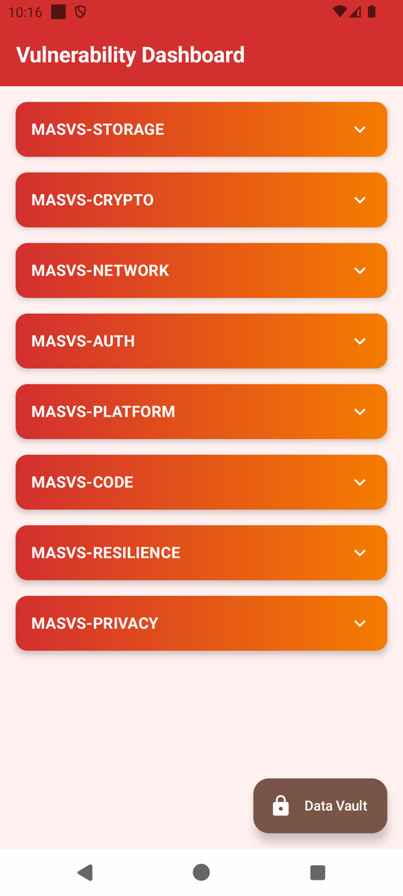

# Lab 00: Set up your lab machine

| | |
|---|---|
| **Time** | ~15 minutes |
| **Goal** | An emulator, a working `adb`, and the vulnerable app installed |
| **You need** | A laptop · one of the emulators below · the app package (downloaded from the release, or built from source) |

!!! warning "Read the lab rules first"
    The rules that apply to every lab (authorized use, evidence, hints) are on the [Labs overview](index.md#before-you-conduct-any-lab). Read them before you set anything up.

This is a one-time setup. Every other lab assumes these steps are done.

---

## Step 1: Get an emulator running

Use one of the two options and stay with it for your labs.

=== "Android Studio emulator"

    1. Install Android Studio (the current release; this project is built with AGP 9.2 and **SDK 37**, so an up-to-date Studio is required).
    2. Open **Device Manager** → **Create device** and pick any recent phone (Pixel 7 is a safe choice).
    3. For the system image, choose **API 34 or newer**.
    4. For later labs, an image **without the Google Play Store** (for example *Google APIs* or *AOSP*) is a good default: the log stays quiet, and `adb root` is available as a fallback if a step asks for it. Any image works, though: the labs read app-private files through the debug build's `run-as`, which needs no root.
    5. Finish the wizard and start the emulator.

=== "Genymotion"

    1. Install Genymotion with a recent Android image (API 34+).
    2. Start the device.
    3. In the Genymotion settings for that device, enabling **root** is optional: the labs read app-private files through the debug build's `run-as`, which needs no root.

## Step 2: Check adb

Android Studio installs `adb` with the SDK, usually here:

```
%LOCALAPPDATA%\Android\Sdk\platform-tools
```

Add that folder to your `PATH`, or open a terminal inside it. Then:

```bash
adb version
adb devices
```

You should see something like:

```
List of devices attached
emulator-5554   device
```

!!! warning "If `adb devices` shows `unauthorized` or nothing"
    - `unauthorized`: accept the debugging prompt on the emulator screen.
    - Empty list: make sure the emulator is fully booted, then run `adb devices` again.
    - `adb: command not found`: your terminal does not have `platform-tools` on `PATH`.

    Run all terminal commands in this course from **Git Bash** on Windows, or from a normal shell on macOS/Linux.

## Step 3: Install the vulnerable app

There are two ways to get the app. Use the one that applies to you.

=== "Download the APK"

    Download `app-vulnerable-debug.apk` from [the lab releases page](https://github.com/azharfatrr/Android-Security-Masterclass/releases).

    From the terminal, in the folder that contains the APK:

    ```bash
    adb install -r app-vulnerable-debug.apk
    ```

    The release page also lists `app-secure-debug.apk` and `app-attacker-debug.apk`. No lab uses those; you only need `app-vulnerable-debug.apk`.

=== "Build it yourself"

    From the root of the project repository:

    ```bash
    # Windows
    gradlew.bat :app-vulnerable:assembleDebug

    # macOS / Linux
    ./gradlew :app-vulnerable:assembleDebug
    ```

    Then install the built package:

    ```bash
    adb install -r app-vulnerable/build/outputs/apk/debug/app-vulnerable-debug.apk
    ```

    The first build downloads dependencies and can take a while. Android Studio will prompt you to install any missing SDK components.

Both routes end with `Success` on the terminal.

## Step 4: Prove your setup works

Run this and read the result:

```bash
adb shell pm path com.hasantuncay.mobsec
```

Expected, a line beginning with `package:`:

```
package:/data/app/~~<random>/com.hasantuncay.mobsec-<random>/base.apk
```

Then open the app on the emulator. You should see the **🎯 MobSec Victim** app: the screen header reads **Vulnerability Dashboard**, and the MASVS categories (MASVS-STORAGE, MASVS-CRYPTO, and so on) fill the page.

{ width="340" }

!!! note "Setup is done when"
    - `adb devices` lists your emulator as `device`
    - `adb shell pm path com.hasantuncay.mobsec` prints a `package:/data/app/...` path
    - The **🎯 MobSec Victim** app opens on the emulator

When all three are true, go to [Lab 01: The Token That Stayed in Plain Sight](lab-01-insecure-private-storage.md).

---

## If your setup fails

| Symptom | Cause | Fix |
|---|---|---|
| `adb: command not found` | `platform-tools` not on `PATH` | Run the terminal from the `platform-tools` folder, or add it to `PATH` |
| `adb devices` shows `offline` | Emulator still booting | Wait, then retry; if it persists, cold-boot the emulator |
| `INSTALL_FAILED_INSUFFICIENT_STORAGE` | Emulator disk full | Wipe the emulator data or create a device with more storage |
| `INSTALL_FAILED_UPDATE_INCOMPATIBLE` | A different build of the app is installed | `adb uninstall com.hasantuncay.mobsec`, then install again |
| Gradle build fails on SDK 37 | Outdated Android Studio | Update Studio and install SDK Platform 37 when prompted |
| Genymotion app closes at launch | ARM translation or image mismatch | Use a recent Genymotion image (API 34+) and reinstall the app |
